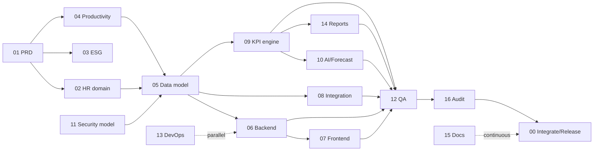

# HRSWI — Ajan Ekibi, Çalışma Alanları ve Protokol

## Gerçek durum beyanı

Bu oturumda "ajanlar" **rol tabanlı iş paketleri** olarak tanımlandı ve **tek bir yapay zekâ geliştirici tarafından sıralı olarak** uygulandı.
Tek istisna **Agent 16 (Bağımsız Denetim)**: kodu yazmamış, ayrı bağlamda çalışan bir alt ajan olarak çalıştırıldı. Bulguları `docs/AUDIT_REPORT.md`'de.
Bu dosya, ileride gerçek paralel ajanlarla (ayrı branch/worktree) çalışmak için sahiplik ve sözleşme sınırlarını tanımlar.

## Ajan matrisi

| ID | Ajan | Sahip olduğu çalışma alanı (yazma yetkisi) | Okur | Teslimatlar |
|---|---|---|---|---|
| 00 | Orchestrator | `PROJECT_PLAN.md`, `TASK_BOARD.md`, `ARCHITECTURE_DECISIONS.md`, `INTEGRATION_CONTRACTS.md`, `RELEASE_PLAN.md`, `AGENTS.md` | her şey | plan, ADR onayı, entegrasyon |
| 01 | Product Owner / BA | `docs/PRD.md`, `docs/SCREEN_MAP.md` | — | PRD, hikâyeler, kabul kriterleri |
| 02 | HR Domain Expert | `backend/app/models/people.py`, `docs/KPI_CATALOG.md` iş tanımları (via `analytics/catalog.py`) | PRD | İK süreç modeli, metrik anlamları |
| 03 | Sustainability & ESG | `analytics/catalog.py` → `FRAMEWORKS`, `FRAMEWORK_REQUIREMENTS` | KPI kataloğu | standart eşleştirme, kapsam |
| 04 | Productivity & Ops | `models/operations.py` (verimlilik bölümü), KPI-004/005/013 kuralları | PRD | meslek grubuna göre ölçüm yöntemi |
| 05 | Data Architect | `backend/app/models/*`, `backend/alembic/*`, `docs/DATA_MODEL.md` | tümü | şema, migration, veri sözlüğü |
| 06 | Backend Engineer | `backend/app/api/*`, `backend/app/services/*`, `backend/app/main.py` | modeller, sözleşmeler | REST API, iş kuralları |
| 07 | Frontend & UX | `frontend/src/*` | API sözleşmesi | tasarım sistemi, ekranlar |
| 08 | Data Integration | `backend/app/services/imports.py`, `services/timekeeping.py` | modeller | import hattı, bağlayıcılar |
| 09 | KPI & Analytics | `backend/app/analytics/*` | modeller | formül motoru, versiyonlama |
| 10 | AI & Forecasting | `backend/app/ai/*` | analytics engine API'si | tahmin, anomali, asistan |
| 11 | Security & Compliance | `backend/app/security/*`, `docs/SECURITY_PRIVACY.md` | tümü | RBAC/ABAC, denetim izi, KVKK |
| 12 | QA & Test | `backend/tests/*`, `frontend/e2e/*` | tümü | birim/entegrasyon/E2E/güvenlik testleri |
| 13 | DevOps | `Dockerfile`'lar, `docker-compose.yml`, `.github/workflows/*`, `backend/scripts/perf_smoke.py` | — | CI/CD, ortamlar, izleme |
| 14 | Reporting & BI | `backend/app/services/reports.py` | engine | rapor şablonları |
| 15 | Documentation | `README.md`, `docs/*` (üretilen dosyalar hariç) | tümü | kılavuzlar, sözlük |
| 16 | Independent Review | yalnızca `docs/AUDIT_REPORT.md` | tümü (salt okunur) | denetim raporu |
| 17 | HR Director (iş tarafı karar sahibi) | `docs/HR_DIRECTOR_RECOMMENDATIONS.md` | tümü (kod yazmaz) | KPI hedef/eşik önerileri, İK politika kararları, tanım onayı — persona: `.claude/agents/hr-director.md` |
| 18 | İSG Uzmanı (HR ekibi, Agent 17'ye bağlı) | `docs/hr/hse/` | tümü (kod yazmaz) | İSG olay sınıflandırması, SGK rapor eşlemesi, güvenlik oranı maruziyet kuralları, İSG import spesifikasyonu — persona: `.claude/agents/hse-specialist.md` |
| 19 | İK Veri ve Metrik Analisti (HR ekibi) | `docs/hr/data/` | tümü (kod yazmaz) | import alan sözlükleri, kod eşlemeleri, el hesaplı KPI formül spesifikasyonları — persona: `.claude/agents/hr-data-analyst.md` |
| 20 | Çalışma Hukuku ve KVKK Analisti (HR ekibi) | `docs/hr/legal/` | tümü (kod yazmaz) | ⚖️ maddelerini insan hukukçu için kapalı uçlu soru dosyalarına çevirir; hukuki görüş/onay vermez — persona: `.claude/agents/labour-law-analyst.md` |

**HR ekibi akışı** (`docs/HR_TEAM_PLAN.md` §2.4): Agent 18/19/20 spesifikasyon yazar → Agent 17 inceler (Onay / Şartlı onay / İade) → Orchestrator görev ve gerekirse ADR açar → mühendislik ajanı uygular → A12 el hesaplarını teste çevirir → Agent 17 demo veride salt okunur kabul kontrolü yapar. İK rolleri mühendisliğe doğrudan iş vermez.

## Bağımlılık ve paralellik planı

- **Sıralı (kritik yol):** 01 → 02/04/11 → 05 → 09 → 10/14 → 12 → 16 → 00
- **Paralel:** 03 ‖ 04; 06 ‖ 08 ‖ 09 (ortak model donduktan sonra); 07 ‖ 10 ‖ 14; 13 ve 15 sürekli.

## Çalışma protokolü (her ajan)

1. **Başlatma:** `TASK_BOARD.md`'den görev ID'sini al; ön koşulların `Done` olduğunu doğrula; etkilenecek dosya ve sözleşmeleri görev kaydına yaz; kabul kriterlerini kopyala.
2. **Geliştirme:** kod + test + hata durumları + doküman; şema değişikliği → yeni Alembic revizyonu (eski revizyon değiştirilmez).
3. **Teslim:** tamamlanan iş, değişen dosyalar, yeni API'ler, migration'lar, çalıştırılan testler ve sonuçları, bilinen eksikler, entegrasyon bağımlılıkları.
4. **Kurallar:** sahip olunmayan alana yazma yok; ortak sözleşme (API şeması, `KpiResult`, `AccessContext`, migration zinciri) değişikliği → önce ADR + Orchestrator onayı; testi geçmeyen iş `Done` olamaz; "test edildi" yalnızca test çalıştırıldıysa yazılır.
5. **Paralel çalışma:** ajan başına branch/worktree (`agent/<id>-<task>`); Orchestrator birleştirmeden önce tüm test paketini ve E2E duman testini çalıştırır.
