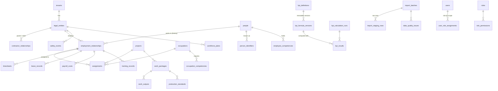

# HRSWI — Veri Modeli · Agent 05

Tam kolon listesi: [`DATA_DICTIONARY.md`](DATA_DICTIONARY.md) (koddan üretilir). Şema: 58 tablo, Alembic `0001` → `0002` → `0003`.

## Temel ayrımlar (Master Prompt §2)
| Kavram | Tablo | Not |
|---|---|---|
| Tüzel kişilik / işveren | `legal_entities` (`entity_type`: client, main_contractor, subcontractor, employer) | Ana ve alt yüklenici aynı tablo; rol ilişkiden gelir |
| Ana ↔ alt yüklenici | `contractor_relationships` (valid_from/to, tier, project, **data_sharing_granted**) | Tarihsel; erişim kapsamını belirler |
| Proje / saha | `projects`, `project_locations` | |
| Organizasyon birimi | `departments` (tüzel kişiliğe bağlı, tarihsel) | |
| Kişi | `people` (+ `person_identifiers`) | İşverenden bağımsız; çok sistemli kimlik eşleme |
| İş ilişkisi | `employment_relationships` | Kişi × işveren × dönem; işveren değişince **yeni satır** |
| Çıkış kodu eşlemesi | `termination_code_map`, `termination_counters` | SGK çıkış kodu → ayrılış kategorisi (tenant verisi, doğrulanmadan etkin değil); saklanmayan kodlar (sağlık, kod 11) yalnızca tüzel kişilik × ay sayacı (ADR-023) |
| Çalışma düzeni ve izin hakkı | `work_patterns`, `work_pattern_assignments` (kişi / proje / işveren, etkin tarihli), `public_holidays` (ülke × tarih × kesir), `leave_entitlement_rules`; `leave_records.days` / `day_basis` / `work_pattern_id`; `employment_relationships.collective_agreement_code` / `leave_seniority_date` | İzin günü ↔ saat düzene göre; düzen çözümleme kişi → birincil görevlendirme projesi → işveren; hak kuralı kaynak belge + onay olmadan etkin değil (ADR-024, migration `0010`) |
| Görevlendirme | `assignments` | İstihdam × proje/departman/pozisyon/meslek × dönem; çoklu ve eşzamanlı |
| Pozisyon / meslek / yetkinlik | `positions`, `occupations` (`occupation_group`), `competencies`, `occupation_competencies`, `employee_competencies` | |
| Planlanan ↔ gerçekleşen iş gücü | `workforce_plans` ↔ `employment_relationships` | KPI-006 |
| Çalışma süresi ↔ sahada bulunma ↔ üretken süre | `timesheets.worked_hours` ↔ `attendance_events` ↔ `timesheets.productive_hours` | Kart verisi ≠ üretken süre |
| Operasyonel çıktı, kalite, yeniden iş | `work_outputs` (quantity, accepted_quantity, rework_*), `production_standards`, `work_packages` | KPI-005/010/013 |

## Çekirdek ER diyagramı

## Kurallar
- **Tarihsellik:** `[valid_from, valid_to)` yarı açık aralık; istihdamda `end_date` dahil son gün. Kapatma + yeni kayıt; `record_version`, `source_system`, `source_record_id`, `updated_by`.
- **Kaynak vs dönüştürülmüş:** `import_staging_rows.raw` (kaynak) ↔ `mapped` (dönüştürülmüş) ↔ hedef tablolar.
- **Köken:** `kpi_results.lineage` (tablolar, sayımlar, hariç tutulan kayıtlar, parametreler).
- **Mükerrer koruma:** `attendance_events.dedup_key` (unique), `timesheets (employment, date, project)` unique, `import_batches` committed dosya hash'i partial unique index, `person_identifiers (tenant, source, external_id)` unique.
- **Çok kiracılık:** her iş tablosunda indeksli `tenant_id`.
- **Önbellek geçersizleştirme:** `tenants.data_version` (migration `0002`).

## Büyük veri notları
- Sık sorgular için bileşik indeksler: `employment_relationships (tenant, legal_entity, start, end)`, `timesheets (tenant, work_date)`, `kpi_results (tenant, kpi, period, scope)`.
- 15K aktif kişi × günlük puantaj ≈ 5.5M satır/yıl → FAZ 7: `timesheets` için aylık range partition ve/veya aylık özet materyalize görünüm (henüz uygulanmadı, ölçülmedi).
